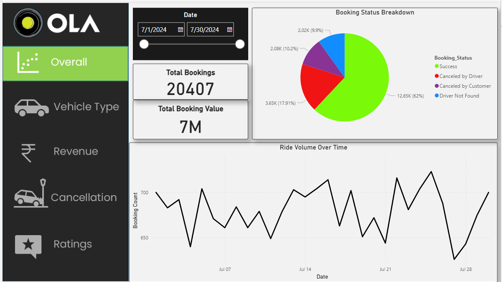
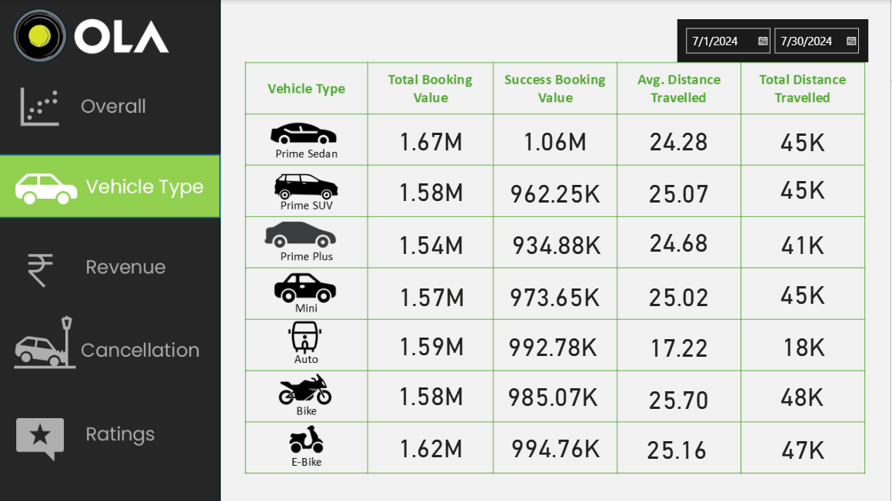
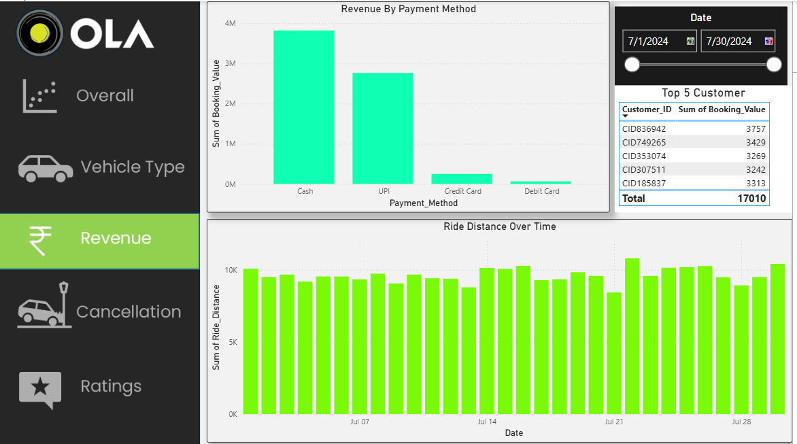
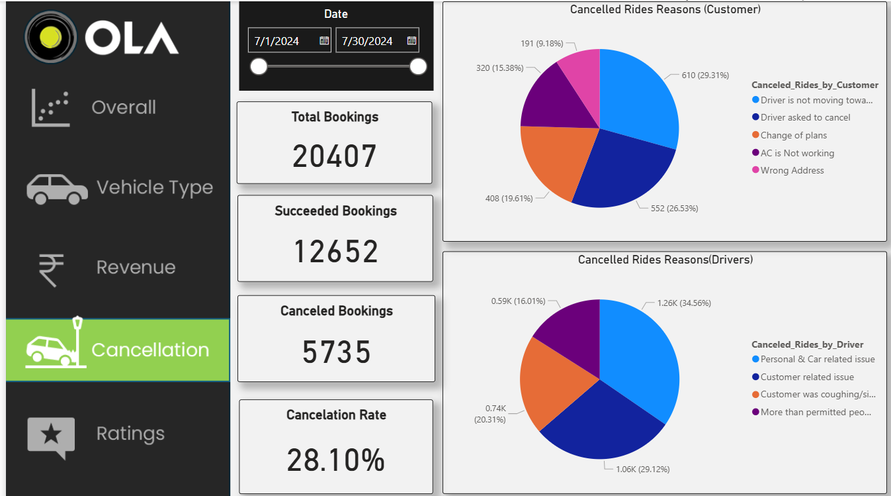
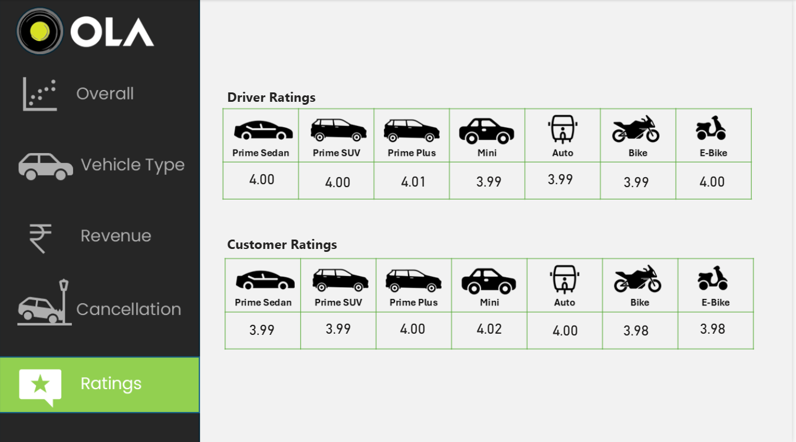

# OLA Ride Data Analysis

**Himanshu Gupta**  
**BCA Graduate**

## Project Overview

This project analyzes OLA ride booking data using SQL and Microsoft Power BI.

The analysis focuses on booking performance, revenue, cancellations, vehicle types, ride distance, payment methods, and customer and driver ratings.

## Tools & Technologies

- SQL
- Microsoft Power BI
- CSV Dataset
- Data Analysis & Visualization

## Key Metrics

- Total Bookings: 20,407
- Successful Bookings: 12,652
- Cancelled Bookings: 5,735
- Cancellation Rate: 28.10%
- Total Booking Value: Approximately 7M

## Analysis Performed

### 1. Overall Analysis

The overall dashboard provides a summary of total bookings, booking value, booking status, and ride volume over time.

### 2. Vehicle Type Analysis

The vehicle analysis compares different vehicle types based on booking value, successful booking value, average distance travelled, and total distance travelled.

### 3. Revenue Analysis

The revenue dashboard analyzes revenue by payment method, ride distance over time, and top customers.

### 4. Cancellation Analysis

The cancellation dashboard analyzes customer and driver cancellation reasons along with overall cancellation metrics.

### 5. Ratings Analysis

The ratings dashboard compares average driver and customer ratings across different vehicle types.

## SQL Analysis

The project includes SQL queries for:

- Successful bookings
- Average ride distance by vehicle type
- Customer cancellations
- Top customers
- Driver cancellation reasons
- Driver ratings
- UPI payments
- Customer ratings
- Successful booking value
- Incomplete rides

## Project Files

- `dataset.xlsx.csv` – OLA booking dataset
- `ola_dashboard.pbix.pbix` – Power BI dashboard
- `sql_queries .sql` – SQL analysis queries
- Dashboard screenshots – Power BI dashboard pages

## Dashboard Pages

- Overall
- Vehicle Type
- Revenue
- Cancellation
- Ratings

## Conclusion

This project demonstrates the use of SQL for data analysis and Power BI for interactive data visualization to derive insights from OLA ride booking data.
